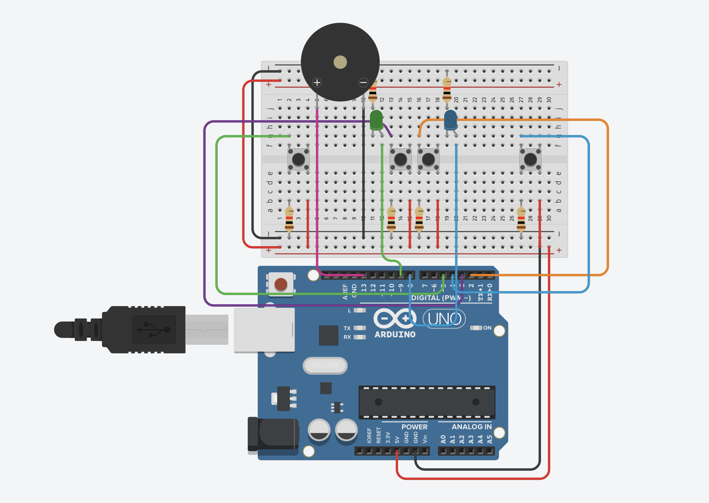
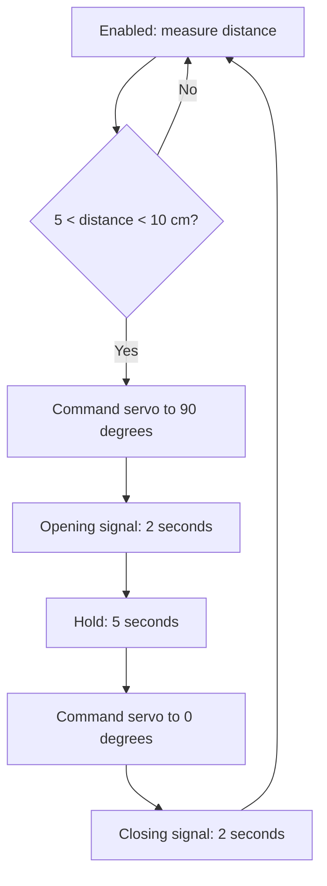

# Arduino Robotics Labs

Arduino coursework in C++ from Vilnius University, Faculty of Mathematics and Informatics, 2024. Four projects cover button input and timing, ultrasonic ranging, motor control with an LCD, and a servo-operated barrier.

Each project includes its original sketch, a pin map, operating instructions and notes on the behavior implemented in the source. A small LED-sequence exercise, alternative game and barrier versions, and component-check fragments are also included.

| Project | Main concepts | Interface |
| --- | --- | --- |
| [Two-player button game](sketches/button_game/) | Press-edge detection, timing, scores and state transitions | Four buttons, two LEDs, sounder and Serial Monitor |
| [Ultrasonic alarm](sketches/ultrasonic_alarm/) | Trigger/echo ranging, external interrupt and TimerOne | Button, distance threshold, LED and buzzer output |
| [Fan controller](sketches/fan_controller/) | PWM output, button-controlled levels and LCD updates | Four power levels on a 16x2 display |
| [Parking barrier](sketches/parking_barrier/) | Distance-triggered servo control and a timed signal sequence | Ultrasonic sensor, LCD, button, LED and sounder |
| [LED sequence](sketches/led_sequence/) | Digital outputs and sequential timing | Four LEDs and the built-in LED |

## Saved circuit illustration



The saved September 2024 image shows the component arrangement for the button-game work. It is an original circuit illustration, not a photograph or a newly validated schematic. Use the [pin maps and wiring guide](docs/wiring.md) together with the selected components' documentation.

## Getting started

### Board and tools

- A classic **Arduino Uno / ATmega328P** is the reference target used by these instructions.
- [Arduino IDE](https://support.arduino.cc/hc/en-us/articles/360019833020-Download-and-install-Arduino-IDE) and the **Arduino AVR Boards** package.
- A USB data cable and the components required by the selected project.
- The libraries listed below.

The saved illustration shows a classic Uno layout. Exact component models and physical circuits for the other projects were not retained. The [wiring guide](docs/wiring.md) distinguishes the signal assignments in the code from component-dependent power and driver connections.

### Libraries

Install any missing libraries through Arduino IDE's Library Manager:

| Project | Library | Maintainer |
| --- | --- | --- |
| Button game and LED sequence | Arduino core only | Arduino |
| Ultrasonic alarm | [TimerOne](https://github.com/PaulStoffregen/TimerOne) | Paul Stoffregen |
| Fan controller | [LiquidCrystal](https://github.com/arduino-libraries/LiquidCrystal) | Arduino |
| Parking barrier | [LiquidCrystal](https://github.com/arduino-libraries/LiquidCrystal), [Servo](https://github.com/arduino-libraries/Servo) | Arduino |

The LCD code uses a parallel four-bit connection. See Arduino's [library installation instructions](https://support.arduino.cc/hc/en-us/articles/5145457742236-Install-libraries-in-the-Arduino-IDE) if a required header is unavailable.

### Open and upload a sketch

```sh
git clone https://github.com/lukamaga/arduino-robotics-labs.git
cd arduino-robotics-labs
```

1. Read the selected project's README and connect its circuit with power disconnected.
2. Open that project's `.ino` file in Arduino IDE. Keep the enclosing folder: its name matches the sketch file, as required by the [Arduino sketch format](https://docs.arduino.cc/arduino-cli/sketch-specification/).
3. Select **Arduino Uno** from the Arduino AVR Boards package and select the board's port.
4. Use **Upload** to program the connected board. The sketch begins running after upload.
5. For the game and alarm, open Serial Monitor at **9600 baud** to view their messages.

Upload one project at a time. The projects reuse pins for different purposes and have separate wiring. Arduino's [upload guide](https://support.arduino.cc/hc/en-us/articles/4733418441116-Upload-a-sketch-in-Arduino-IDE) covers board and port selection.

## Project behavior

### 1. Two-player button game

Press the power button to enable the game, then press restart to begin a round. After a randomly selected one- or two-second delay, both LEDs signal the start. Players compete by pressing their respective buttons; the program counts press edges and indicates the higher score with an LED. A tie lights both LEDs.

The configured round duration is five seconds, measured from before the 500 ms start indication. Serial Monitor prints updated scores. The source also includes the enable/restart state and sound cues.

[Controls, pins and timing details](sketches/button_game/README.md)

### 2. Ultrasonic alarm

A button interrupt toggles the system. While enabled, the sketch requests periodic distance measurements and activates the LED and buzzer output when the integer distance is at most 50 cm.

A one-second TimerOne interrupt increments a counter. At a count of five, the main loop also attempts a 500 ms alternating indication. Distance measurements and the timer branch both write the outputs, so the recorded implementation is described in detail in the lab guide.

[Distance calculation, timer behavior and wiring](sketches/ultrasonic_alarm/README.md)

### 3. Fan controller with LCD

Each detected button press advances through four levels. The LCD shows `Off`, `25%`, `50%` and `100%`. These are the program's level labels; the actual PWM commands are:

| LCD label | `analogWrite` value | Approximate duty on the Uno |
| --- | ---: | ---: |
| Off | 0 | 0% |
| 25% | 16 | 6.3% |
| 50% | 32 | 12.5% |
| 100% | 64 | 25.1% |

The code does not measure motor speed. D9 controls a suitable motor-driver stage; the motor requires an appropriate power path. [Fan pin map and operation](sketches/fan_controller/README.md)

### 4. Servo parking barrier

Enable the system with its button. A measured integer distance strictly between 5 and 10 cm triggers the barrier sequence. The sketch commands the servo to 90 degrees, signals for two seconds, waits another five seconds, then commands zero degrees and signals again.



The sequence blocks input polling while the signals and hold delay run. The code provides no mechanical position feedback or closing-time obstacle check. The main sketch also shows `Scan your car` on the LCD between cycles.

[Barrier wiring, timing and controls](sketches/parking_barrier/README.md) · [Alternative saved version](archive/barrier_text_variant/)

### LED-sequence exercise

The additional sketch lights D5, D6, D4 and D3 in order, with a one-second delay at each stage. The built-in LED is active during the first stage. [LED-sequence guide](sketches/led_sequence/README.md)

## Repository layout

```text
sketches/
  button_game/             Four-button, two-player game
  ultrasonic_alarm/        Ranging with button and timer interrupts
  fan_controller/          PWM levels and parallel LCD
  parking_barrier/         Ultrasonic sensor, servo and LCD
  led_sequence/            Introductory digital-output exercise
archive/
  barrier_text_variant/    Alternative preserved barrier sketch
  button_counter_variant/ Original counter prototype
  component_checks/       Saved LED, button and sounder snippets
docs/
  assets/                  Original circuit illustration
  wiring.md                Component and connection guide
  provenance.json          Original files and extraction details
ATTRIBUTION.md             Coursework source record
```

The original algorithms and source comments are retained. Code saved in text notes has been extracted into Arduino sketch folders; duplicate drafts and unrelated material are separated from the main projects. The source correspondence, pin tables and documentation were reviewed without compiling, uploading or running the sketches.

## Author

Lukaš Patrik Magalinski, Vilnius University, Faculty of Mathematics and Informatics. Robotics coursework, 2024.

See [ATTRIBUTION.md](ATTRIBUTION.md) for source selection and third-party library references.
